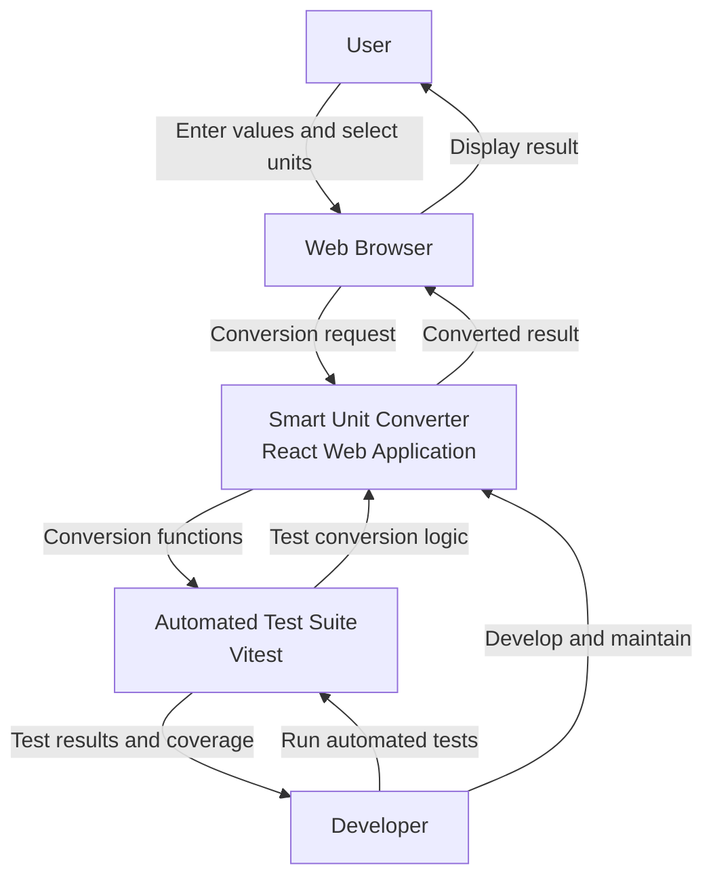

# Context Diagram
## Project: Smart Unit Converter

The context diagram illustrates the interactions between the user, the Smart Unit Converter application, the web browser, and the developer's testing environment.

